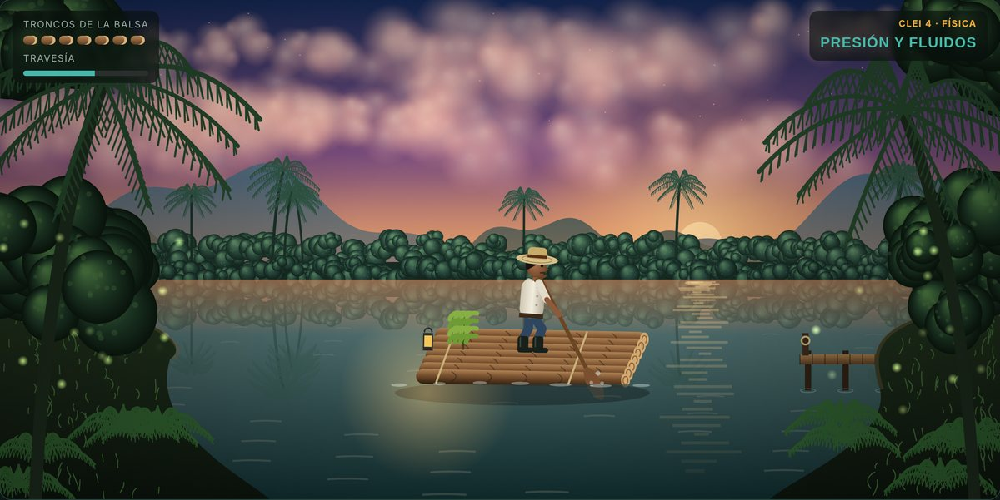

# Río de Números

Ahorcado de **matemáticas y física para los CLEI 1 a 6** (educación de jóvenes y adultos), ambientado en el Putumayo. Un remero cruza el río Guamuez en una balsa de troncos: cada letra acertada lo acerca al muelle y cada error parte un tronco de la balsa.



## Cómo se juega

- Elige el **ciclo** (CLEI 1 a 6) y el **área** (Matemáticas o Física).
- Lee la pista y adivina el concepto letra por letra, con el teclado en pantalla o el del computador. Las tildes no hay que teclearlas: al acertar la A aparece también la Á.
- **Acierto**: la balsa avanza hacia el muelle de la otra orilla.
- **Error**: se agrieta y se parte un tronco. La balsa tiene 7 troncos.
- **Reto del río** (2 por palabra): resuelve un problema del mismo tema con situaciones de la región. Si aciertas, se destapa una letra; si fallas, se pierde un tronco. Siempre se muestra la explicación del procedimiento.
- Se puede filtrar por tema. El juego lleva puntos, racha y un récord por ciclo y área, que se guarda en el navegador.

## Contenido por ciclo

| Ciclo | Grados | Matemáticas | Física |
|---|---|---|---|
| **CLEI 1** | 1.° a 3.° | Números y conteo · Suma y resta · Multiplicar y repartir · Figuras y formas · Medidas, tiempo y dinero (29 palabras, 18 retos) | La materia y sus estados · Fuerza y movimiento · Luz y sombra · El sonido · Calor e imanes (27 palabras, 15 retos) |
| **CLEI 2** | 4.° y 5.° | Operaciones con naturales · Fracciones y decimales · Ángulos y figuras · Medición · Datos y probabilidad (29 palabras, 19 retos) | Máquinas simples · Electricidad · Fuentes de energía · Calor y temperatura · Luz y sonido (25 palabras, 15 retos) |
| **CLEI 3** | 6.° y 7.° | Divisibilidad · Números enteros · Fracciones y decimales · Geometría · Estadística · Proporcionalidad · Potencias y raíces (39 palabras, 28 retos) | Propiedades de la materia · Fuerzas · Movimiento · Energía · Magnetismo (24 palabras, 14 retos) |
| **CLEI 4** | 8.° y 9.° | Números reales · Expresiones algebraicas · Ecuaciones y funciones · Geometría y medida · Estadística y probabilidad (28 palabras, 17 retos) | Movimiento · Presión y fluidos · Ondas, sonido y luz · Electricidad (23 palabras, 13 retos) |
| **CLEI 5** | 10.° | Trigonometría · Geometría analítica · Cónicas · Conteo y estadística (23 palabras, 15 retos) | Cinemática · Leyes de Newton · Trabajo, energía y potencia · Cantidad de movimiento (21 palabras, 14 retos) |
| **CLEI 6** | 11.° | Funciones · Exponenciales y logaritmos · Límites y derivadas · Sucesiones e inecuaciones · Probabilidad (26 palabras, 18 retos) | Movimiento ondulatorio · Óptica · Termodinámica · Electromagnetismo · Física moderna (28 palabras, 17 retos) |

En física, los CLEI 1 a 4 trabajan el **entorno físico** de los Estándares Básicos de Competencias en Ciencias Naturales; los CLEI 5 y 6 corresponden a la asignatura de física de la educación media.

## Enlaces directos por ciclo

Agrega al final de la dirección del sitio el ciclo y el área, por ejemplo:

```
https://tu-sitio.netlify.app/#clei1-matematicas
https://tu-sitio.netlify.app/#clei4-fisica
```

Sirve para dejar a cada grupo su enlace en el aula virtual o en el grupo de WhatsApp.

## Estructura del proyecto

```
rio-de-numeros/
├── index.html          Página principal
├── css/estilos.css     Estilos
├── js/contenido.js     Ciclos, palabras, pistas y problemas (el archivo que más vas a editar)
├── js/escena.js        Escena animada del río en canvas
├── js/juego.js         Lógica del juego
├── assets/             Ícono y vista previa
├── netlify.toml        Configuración de Netlify
└── README.md
```

No usa frameworks ni necesita compilación: es HTML, CSS y JavaScript puro.

## Agregar palabras o problemas

Abre `js/contenido.js`. Cada banco se llama `BANCO["ciclo-área"]`, por ejemplo `BANCO["4-fis"]`, y tiene tres partes: `temas`, `palabras` y `problemas`.

**Una palabra nueva** va en `palabras` con el formato `[tema, "PALABRA", "pista"]`. Escríbela con sus tildes; el juego las muestra pero no obliga a teclearlas:

```js
["geo","TRAPECIO","Cuadrilátero que tiene solo un par de lados paralelos."],
```

**Un problema nuevo** va en `problemas` con el formato `[tema, "pregunta", "respuesta correcta", ["distractor", "distractor", "distractor"], "explicación"]`:

```js
["pro","Si 2 libras de queso cuestan $16.000, ¿cuánto cuestan 3 libras?","$24.000",["$18.000","$32.000","$48.000"],"Una libra cuesta 16.000 ÷ 2 = 8.000. Entonces 3 × 8.000 = 24.000."],
```

**Un tema nuevo** se agrega en `temas` con un código corto y su nombre, y luego se usa ese código en las palabras y problemas. Cada tema necesita al menos una palabra y un problema.

Códigos de tema de cada banco:

| Banco | Ciclo y área | Temas |
|---|---|---|
| `1-mat` | CLEI 1 · Matemáticas | `num` Números y conteo, `ope` Suma y resta, `mul` Multiplicar y repartir, `geo` Figuras y formas, `med` Medidas, tiempo y dinero |
| `1-fis` | CLEI 1 · Física | `est` La materia y sus estados, `fue` Fuerza y movimiento, `luz` Luz y sombra, `son` El sonido, `cal` Calor e imanes |
| `2-mat` | CLEI 2 · Matemáticas | `ope` Operaciones con naturales, `fra` Fracciones y decimales, `geo` Ángulos y figuras, `med` Medición, `dat` Datos y probabilidad |
| `2-fis` | CLEI 2 · Física | `maq` Máquinas simples, `ele` Electricidad, `ene` Fuentes de energía, `cal` Calor y temperatura, `luz` Luz y sonido |
| `3-mat` | CLEI 3 · Matemáticas | `div` Divisibilidad, `ent` Números enteros, `fra` Fracciones y decimales, `geo` Geometría, `est` Estadística, `pro` Proporcionalidad, `pot` Potencias y raíces |
| `3-fis` | CLEI 3 · Física | `mat` Propiedades de la materia, `fue` Fuerzas, `mov` Movimiento, `ene` Energía, `mag` Magnetismo |
| `4-mat` | CLEI 4 · Matemáticas | `rea` Números reales, `alg` Expresiones algebraicas, `ecu` Ecuaciones y funciones, `geo` Geometría y medida, `est` Estadística y probabilidad |
| `4-fis` | CLEI 4 · Física | `mov` Movimiento, `flu` Presión y fluidos, `ond` Ondas, sonido y luz, `ele` Electricidad |
| `5-mat` | CLEI 5 · Matemáticas | `tri` Trigonometría, `ana` Geometría analítica, `con` Cónicas, `cnt` Conteo y estadística |
| `5-fis` | CLEI 5 · Física | `cin` Cinemática, `din` Leyes de Newton, `tra` Trabajo, energía y potencia, `mom` Cantidad de movimiento |
| `6-mat` | CLEI 6 · Matemáticas | `fun` Funciones, `exp` Exponenciales y logaritmos, `lim` Límites y derivadas, `suc` Sucesiones e inecuaciones, `pro` Probabilidad |
| `6-fis` | CLEI 6 · Física | `ond` Movimiento ondulatorio, `opt` Óptica, `ter` Termodinámica, `ele` Electromagnetismo, `mod` Física moderna |

## Probar en tu computador

Basta con abrir `index.html` en el navegador. Si prefieres un servidor local:

```bash
python -m http.server 8000
```

y entra a `http://localhost:8000`.

## Subir a GitHub

```bash
cd rio-de-numeros
git init
git add .
git commit -m "Río de Números: ahorcado de matemáticas y física CLEI 1 a 6"
git branch -M main
git remote add origin https://github.com/TU-USUARIO/rio-de-numeros.git
git push -u origin main
```

Antes, crea el repositorio vacío `rio-de-numeros` en github.com (sin README, para que no haya conflicto).

Si ya habías subido la versión anterior, reemplaza los archivos de tu carpeta por los de esta y ejecuta:

```bash
git add .
git commit -m "Todos los ciclos CLEI con matemáticas y física"
git push
```

## Publicar en Netlify

**Opción A, conectado a GitHub (recomendada).** Cada vez que subas cambios al repositorio, Netlify actualiza el sitio solo.

1. Entra a [app.netlify.com](https://app.netlify.com) e inicia sesión con tu cuenta de GitHub.
2. *Add new site* → *Import an existing project* → *GitHub*.
3. Elige el repositorio `rio-de-numeros`.
4. Deja el comando de compilación vacío y el directorio de publicación en `.` (ya viene configurado en `netlify.toml`).
5. *Deploy*. En un minuto tendrás una dirección como `https://nombre-aleatorio.netlify.app`.
6. En *Site configuration* → *Change site name* puedes cambiarla, por ejemplo a `rio-de-numeros-clei`.

**Opción B, sin GitHub.** Entra a [app.netlify.com/drop](https://app.netlify.com/drop) y arrastra la carpeta `rio-de-numeros` completa.

## Para el docente

- Proyecte el juego en el aula y divida el grupo en equipos que se turnan por letra.
- Antes de destapar la palabra, pida que expliquen en voz alta por qué encaja con la pista.
- El Reto del río funciona bien como pausa para resolver en el cuaderno antes de elegir la respuesta.

Basado en los Estándares Básicos de Competencias en Matemáticas y en Ciencias Naturales (MEN) y en la organización por ciclos del Decreto 3011 de 1997, hoy compilado en el Decreto 1075 de 2015.
